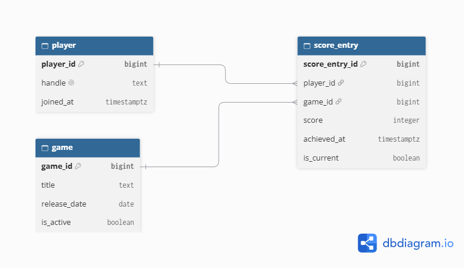

# Portfolio 1: Database Design and Modelling

## 1. Case Study Overview
This relational database supports a **Real-time Game Leaderboard** system. It handles user management (`player`), game cataloguing (`game`), and historical/active leaderboard records (`score_entry`).

## 2. Entity-Relationship (ER) Diagram

## 3. Relational Schema & Tables
* **portfolio.player**: Stores player account information (`player_id`, `handle`, `joined_at`).
* **portfolio.game**: Stores catalog of supported games (`game_id`, `title`, `release_date`, `is_active`).
* **portfolio.score_entry**: Tracks points achieved by players per game (`score_entry_id`, `player_id`, `game_id`, `score`, `achieved_at`, `is_current`).

## 4. Keys and Constraints
* **Primary Keys**: `pk_player` on `player_id`, `pk_game` on `game_id`, `pk_score_entry` on `score_entry_id`.
* **Foreign Keys**: `fk_score_entry_0` referencing `player(player_id)` and `fk_score_entry_1` referencing `game(game_id)`.
* **Domain Constraints**: `CHECK ("score" >= 0)` ensures non-negative scores. `UNIQUE ("handle")` prevents duplicate usernames.
* **Partial Index Constraint**: `one_current_score_per_game` enforces that each player has at most one active (`is_current IS NOT NULL`) leaderboard entry per game.
* **Constraint Verification**: Automated testing statements covering all primary keys, foreign keys, nullability checks, and domain checks are provided in [`ConstraintTests.sql`](./ConstraintTests.sql).

## 5. Normalisation Explanation (3NF Verification)
* **First Normal Form (1NF)**: All columns hold atomic, single-valued entries (e.g., handles, single integer scores, single timestamp values).
* **Second Normal Form (2NF)**: The schema is in 1NF and all non-key columns depend on the complete primary key of their respective table.
* **Third Normal Form (3NF)**: The schema is in 2NF and contains no transitive dependencies (no non-key attribute depends on another non-key attribute).
