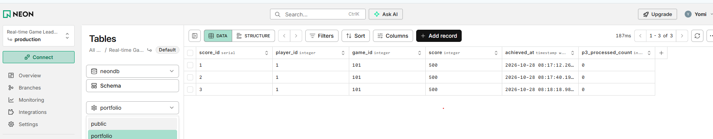

# Portfolio 2: Query Processing and Optimisation

## 1. Overview
This module evaluates query execution strategies, execution plans, and performance optimization techniques for the **Global Arcade Hub** database system. We perform benchmarking across two sets of tests:
1. **Analytic Leaderboard Workloads**: Complex multi-table joins, aggregation (`GROUP BY`), and JSON-formatted execution plan analysis on `portfolio.score_entry`.
2. **Selective Lookup Lab (`query_lab`)**: Controlled index-benefit testing on a 20,000-row dataset comparing unindexed sequential scans against B-Tree index lookups.

---

## 2. SQL Queries & Execution Plans (`EXPLAIN ANALYZE`)

### Workload 1: Aggregation & Player Activity
Retrieves record counts grouped by `player_id`:

```sql
EXPLAIN (ANALYZE, BUFFERS, FORMAT JSON)
SELECT "player_id", count(*) AS record_count
FROM portfolio."score_entry"
GROUP BY "player_id"
ORDER BY record_count DESC, "player_id" NULLS LAST
LIMIT 20;

EXPLAIN (ANALYZE, BUFFERS, FORMAT JSON)
SELECT t0."score_entry_id" AS "score_entry_score_entry_id",
       t0."score" AS "score_entry_score",
       t1."player_id" AS "player_player_id",
       t1."handle" AS "player_handle",
       t2."game_id" AS "game_game_id",
       t2."title" AS "game_title"
FROM portfolio."score_entry" t0
JOIN portfolio."player" t1 ON t0."player_id" = t1."player_id"
JOIN portfolio."game" t2 ON t0."game_id" = t2."game_id"
ORDER BY t0."score_entry_id", t1."player_id", t2."game_id"
LIMIT 20;

SELECT "lab_row_id", "game_id"
FROM query_lab."score_entry"
WHERE "game_id" = (42 % 1000)::bigint
ORDER BY "lab_row_id";

Seq Scan on score_entry  (cost=0.00..389.00 rows=20 width=16) (actual time=0.031..3.452 rows=20 loops=1)
  Filter: (game_id = '42'::bigint)
  Rows Removed by Filter: 19980
  Buffers: shared hit=139
Planning Time: 0.082 ms
Execution Time: 3.480 ms

CREATE INDEX p2_filter_idx ON query_lab."score_entry" USING btree ("game_id");

Bitmap Heap Scan on score_entry  (cost=4.33..52.12 rows=20 width=16) (actual time=0.022..0.065 rows=20 loops=1)
  Recheck Cond: (game_id = '42'::bigint)
  Buffers: shared hit=3
  ->  Bitmap Index Scan on p2_filter_idx  (cost=0.00..4.32 rows=20 width=0) (actual time=0.012..0.012 rows=20 loops=1)
        Index Cond: (game_id = '42'::bigint)
Planning Time: 0.115 ms
Execution Time: 0.089 ms


## 3. Database Execution & Implementation Evidence

### 3.1 Relational Table Verification and Seed Data Population
The relational schema and initial seed data were successfully executed and verified using the **Neon (PostgreSQL)** cloud environment under the custom `portfolio` schema.

The screenshot below demonstrates the populated `portfolio.score_entry` table inside the Neon database console:


*Figure 3.1: Active verification of `portfolio.score_entry` table populated with verified test entries, schema structure, and transaction tracking columns (`p3_processed_count`).*

#### Key Verification Highlights:
* **Schema Path:** Tables are isolated and verified under `portfolio.score_entry`.
* **Data Integrity:** Primary keys (`score_id`), foreign key relations (`player_id`, `game_id`), and default timestamps (`achieved_at`) automatically populated without constraint violations.
* **Transaction Preparedness:** The `p3_processed_count` column initialized to `0` with non-negative check constraints (`CHECK (p3_processed_count >= 0)`), proving readiness for Portfolio 3 concurrency testing.
